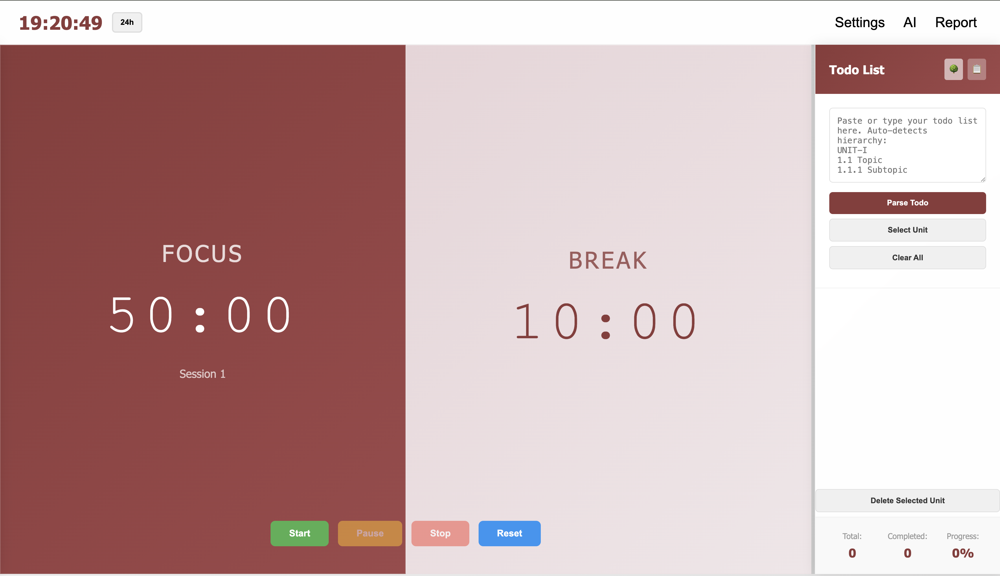
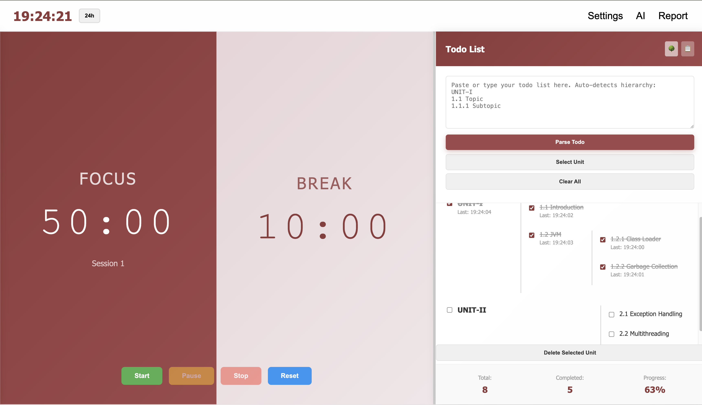
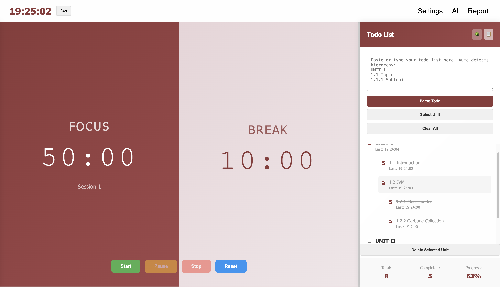
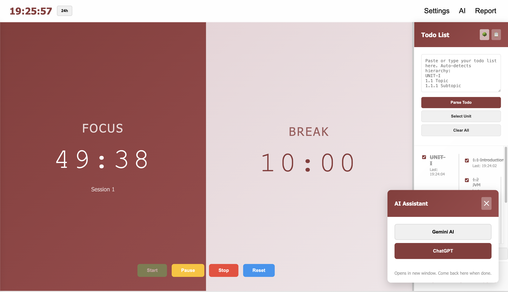
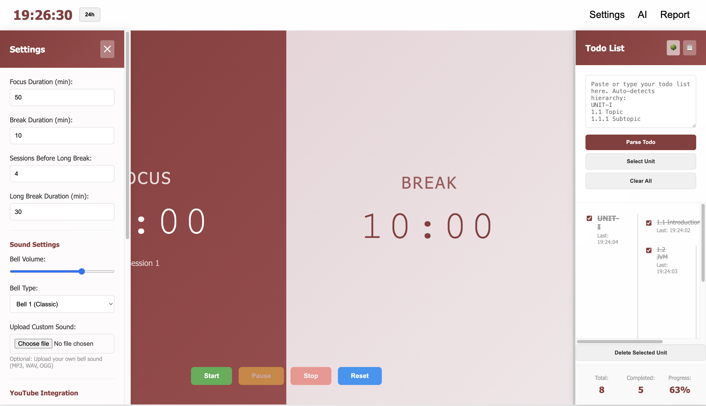
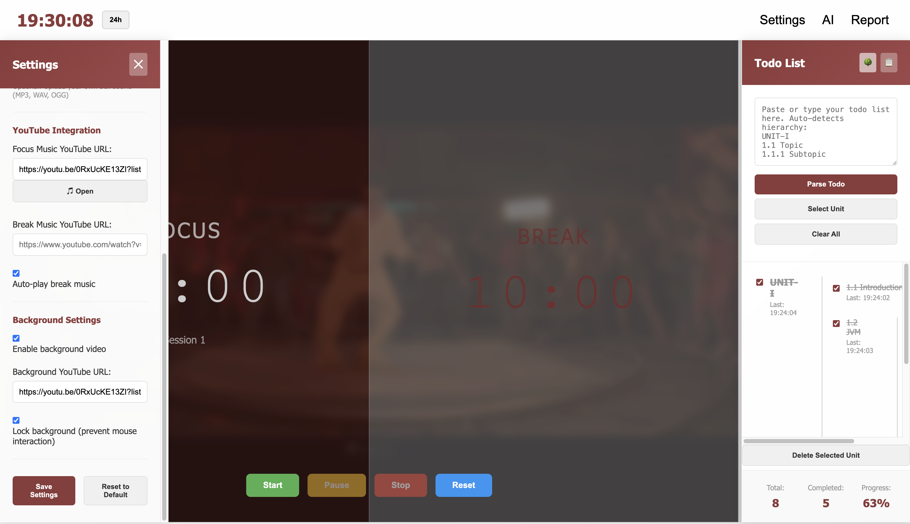
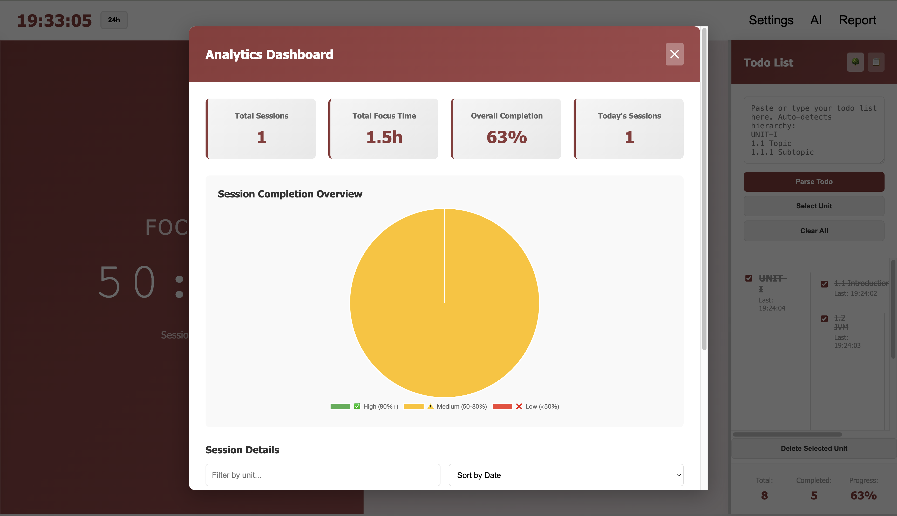
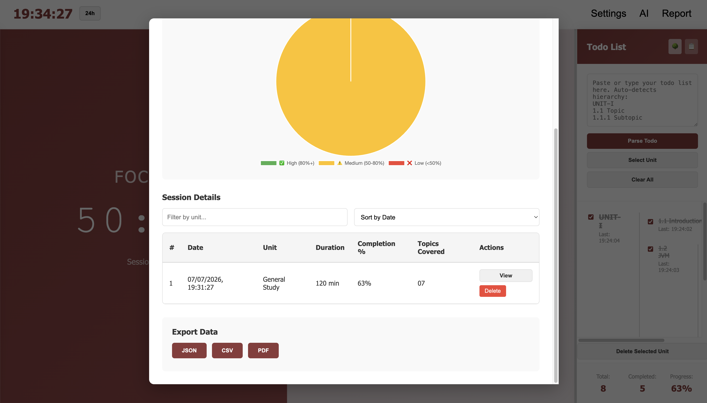

# Study Companion

A browser-based productivity application that combines a **Pomodoro timer**, **hierarchical syllabus planner**, **study analytics**, and **progress tracking** into a single workspace.

Built using **HTML, CSS and Vanilla JavaScript**, the application helps students organize study topics, monitor progress, analyze study sessions, and maintain focus—all without requiring an account or backend.

---

## 🚀 Live Demo

🌐 **https://study-companion-byatharvashah.netlify.app/**

---

# ✨ Features

## ⏱️ Pomodoro Timer

- Configurable focus duration
- Configurable short break duration
- Configurable long break duration
- Automatic focus ↔ break transitions
- Session counter
- Start, Pause, Stop and Reset controls
- Live countdown timer
- 12-hour / 24-hour clock toggle
- Audio notification bell
- Automatic session logging

---

## 📚 Hierarchical Study Planner

Convert an entire syllabus into a structured todo list.

Example input:

```text
UNIT-I
1.1 Introduction
1.2 JVM
1.2.1 Class Loader
1.2.2 Garbage Collection

UNIT-II
2.1 Exception Handling
2.2 Multithreading
```

Automatically generates a hierarchical study tree.

Features include:

- Automatic hierarchy detection
- Tree View
- Flat View
- Unlimited nesting levels
- Progress tracking
- Completion timestamps
- Unit selection
- Delete individual units
- Clear all todos

---

## 📈 Analytics Dashboard

Track your productivity using built-in analytics.

Includes:

- Total study sessions
- Total focus hours
- Today's sessions
- Overall completion percentage
- Interactive completion chart
- Session history
- Detailed session information

---

## 💾 Local Storage

Everything is automatically saved inside your browser.

The application stores:

- Todos
- Study sessions
- Analytics
- User settings
- Selected units

No account or backend is required.

---

## 📤 Export Support

Export your study data in multiple formats.

Supported formats:

- JSON
- CSV
- PDF Report

---

## 🎵 Media Integration

Customize your study environment.

Features include:

- Focus music shortcut
- Break music shortcut
- Configurable notification sounds
- Background YouTube video support
- Adjustable notification volume

---

## 🤖 AI Quick Launcher

Quick access to:

- ChatGPT
- Google Gemini

Useful for asking doubts or understanding concepts without leaving the study workflow.

---

## ⚙️ Customization

Customize the application according to your preferences.

Available settings include:

- Focus duration
- Break duration
- Long break duration
- Sessions before long break
- Notification sound
- Sound volume
- Clock format
- Auto-play break music
- Background video
- Video interaction lock

---

## 📱 Responsive Design

Optimized for:

- Desktop
- Laptop
- Tablet
- Mobile devices

---

## 🖱️ Additional Features

- Adjustable todo sidebar
- Session tracking
- Study statistics
- Beautiful gradient interface
- Local-first architecture
- No login required
- Lightweight and fast

---

# 🛠️ Built With

- HTML5
- CSS3
- Vanilla JavaScript (ES6)
- Chart.js
- html2pdf.js
- Local Storage API

---

# 📂 Project Structure

```text
Study-Companion
│
├── index.html
├── styles.css
├── app.js
│
├── assets
│   ├── icons
│   └── screenshots
│
├── LICENSE
└── README.md
```

---

# 📸 Screenshots

## Home



---

## Tree View



---

## Hierarchical View



---

## Quick AI Access



---

## Settings



---

## Youtube background video



---

## Reports Dashboard




---

# 🚀 Getting Started

Clone the repository.

```bash
git clone https://github.com/AtharvaShah-Git/study-companion
```

Navigate to the project.

```bash
cd study-companion
```

Open the project using **VS Code Live Server** or any local web server.

No installation or package manager is required.

---

# 💡 Future Improvements

- Dark mode
- Drag-and-drop todo ordering
- Keyboard shortcuts
- Study streak tracking
- Calendar integration
- Cloud synchronization
- Import existing todo lists
- PWA support
- Offline installation
- Better analytics visualizations

---

# 🤝 Contributing

Contributions are welcome.

If you find a bug or have an idea for improvement, feel free to:

- Open an Issue
- Submit a Pull Request
- Suggest new features

---

# 📄 License

This project is licensed under the MIT License.

See the **LICENSE** file for more information.

---

# 👨‍💻 Author

**Atharva Shah**

GitHub:
https://github.com/AtharvaShah-Git

---

## ⭐ If you found this project useful, consider giving it a star.